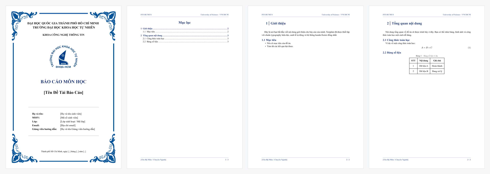

# Typst Academic Report Template

[](https://typst.app/)
[](LICENSE)
[](main.pdf)
[](https://hcmus.edu.vn)

A clean, modular, and publication-ready academic report template built with [Typst](https://typst.app). Designed for coursework, technical reports, and term projects at VNU-HCM University of Science (HCMUS) and extensible for any academic institution.


## Features

- **Decoupled Architecture:** Strict separation between document metadata (`metadata.typ`), formatting rules (`src/`), and chapter contents (`content/`).
- **Standardized Typography:** Optimized for Vietnamese typography and complex mathematical typesetting with Times New Roman and Consolas font pairings.
- **Customizable Cover Page:** Pre-configured cover border, institutional logo, course metadata, and author attribution block.
- **Header, Footer and Outline:** Automated page numbering, section header tracking via `chic-hdr`, and custom-aligned table of contents.
- **Syntax Highlighting:** Styled code blocks with line numbering and container styling.


## Directory Structure

```text
Report_Template_Typst/
├── assets/
│   ├── border.png          # Cover page border asset
│   └── logo.png            # Institutional logo
├── content/
│   ├── 01_intro.typ        # Sample introduction chapter
│   └── 02_summary.typ      # Sample summary chapter
├── src/
│   ├── template.typ        # Core layout engine, cover page, headers/footers
│   └── theme.typ           # Palette, fonts, and codeblock styling
├── metadata.typ            # Centralized project and author metadata
├── main.typ                # Document entry point
├── main.pdf                # Pre-compiled sample output
├── .gitignore
└── LICENSE                 # MIT License
```


## Getting Started

### Prerequisites

Install the Typst compiler via your preferred package manager:

```bash
# Windows (Winget)
winget install --id Typst.Typst

# macOS (Homebrew)
brew install typst

# Linux (Cargo)
cargo install --locked typst-cli
```

*Recommended Editor:* **VS Code** with the **Tinymist Typst** extension for real-time preview and autocompletion.

### Compilation

Compile the report into a PDF:

```bash
# Single compilation
typst compile main.typ

# Live watch mode (auto-recompiles on save)
typst watch main.typ
```


## Configuration

All report parameters are centralized in `metadata.typ`. You do not need to modify formatting files to customize your document:

```typst
#let project_title = "SUBJECT / PROJECT TITLE"
#let project_subtitle = "Detailed Topic or Assignment Name"
#let university = "VIETNAM NATIONAL UNIVERSITY - HO CHI MINH CITY\nUNIVERSITY OF SCIENCE"
#let faculty = "FACULTY OF INFORMATION TECHNOLOGY"
#let course = "Course Name"
#let author_name = "Tien Dang"
#let author_id = "24120149"
#let author_email = "12092k6@gmail.com"
#let instructor_name = "Instructor Name"
```


## Preview

<p align="center">
  
</p>

## License

This project is licensed under the [MIT License](LICENSE).
